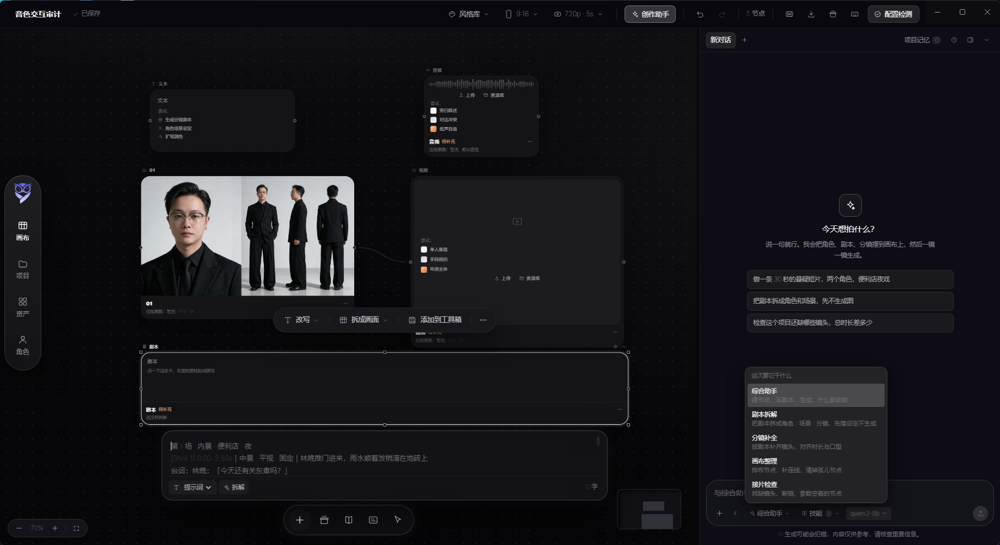
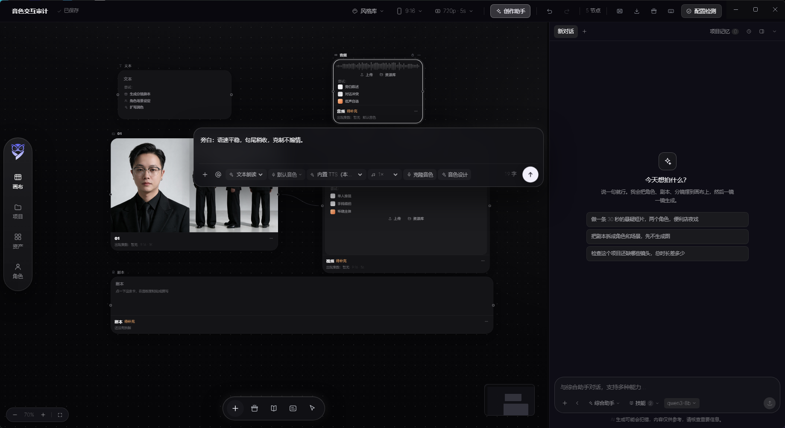
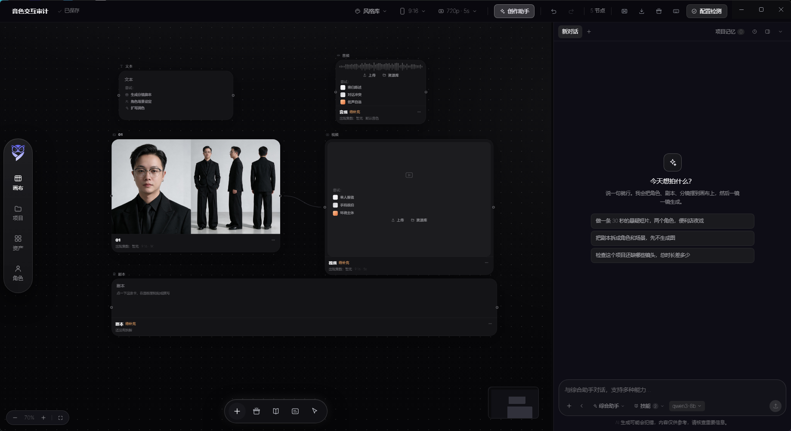

<div align="center">

# 艺镜 Studio · YiJing Studio

**画布优先的 AI 影像创作工作台**

把剧本、角色、分镜、出图、出片串成一张可以随便拖的无限画布。
Windows 桌面端 · Electron + React + React Flow · 全部模型跑在本机，不连任何云端 API


</div>

---

## ⚠️ 使用声明（请务必先读）

> **本项目禁止商用。**
>
> 本项目以「源码可见但受限」的方式公开发布，**不是** OSI 定义的开源软件。
> 允许：个人学习、研究、技术评估、非商业的个人创作。
> 禁止：任何形式的商业用途 —— 包括但不限于公司内部生产使用、对外承接项目、
> 打包进商业产品销售、SaaS 化对外提供服务、以本项目的衍生物收费。
>
> 完整条款见 [LICENSE](LICENSE)。摘要如下：
>
> 1. **禁止商业使用**。任何直接或间接获取经济利益的场景都需要事先取得书面授权。
> 2. **代码以混淆形式发布**。仓库内 `app/` 下是可运行的构建产物，不含可读源码。
>    对产物做反混淆、逆向工程后另行发布，视为违反本许可。
> 3. **模型权重不随本仓库分发**。对话、图像、视频、语音、超分五个模型包需要自行下载，
>    并各自遵守其原始许可（Qwen / MiniMax 等）。模型许可与本项目许可相互独立。
> 4. **生成内容责任自负**。使用者须自行确保输入素材与生成结果不侵犯他人肖像权、
>    著作权，不违反所在地法律法规。
> 5. **不提供任何担保**。软件按「现状」提供，作者不对数据丢失、生成结果、商业损失负责。
>
> 如果你希望获得商用授权，请通过仓库 Issue 联系作者。

---

## 目录

- [这是什么](#这是什么)
- [界面导览](#界面导览)
- [核心能力](#核心能力)
- [快速开始](#快速开始)
- [本地模型](#本地模型)
- [系统要求](#系统要求)
- [快捷键](#快捷键)
- [仓库结构](#仓库结构)
- [技术架构](#技术架构)
- [隐私与网络](#隐私与网络)
- [常见问题](#常见问题)
- [已知限制](#已知限制)
- [许可](#许可)

---

## 这是什么

市面上的 AI 影像工具大体分两类：一类是「一个输入框出结果」的黑盒，另一类是「一堆参数面板」
的传统剪辑软件。真要做一支有角色、有分镜、有台词连贯性的短片，两类都不顺手 ——
前者记不住上下文，后者要你手工把每一步接起来。

艺镜 Studio 取中间那条路：**把整条生产链路摊在一张画布上。**

一张画布 = 一个项目。你在画布上摆节点，节点之间拉线，上游的内容会真的流进下游：

```
剧本 ──► 角色 ×3 ──► 分镜板 ──► 视频 ×12 ──► 成片预览 ──► 导出 MP4
  │                     ▲
  └──► 文本（风格约束）──┘
```

- 连线**不是画着好看**：视频接到成片预览，会真的进「镜头顺序」；角色接到角色集，会真的进「角色清单」；断线就摘掉。
- 连线**只按矩阵放行**：角色卡只能连剧本 / 视频 / 分镜，画布上不会出现无意义的线。
- 每个节点卡片上能点的控件，都必须改动**真正提交给模型的那个字段**，否则不显示 —— 没有装饰性按钮。
- 右侧「创作助手」是一个能读画布、也能改画布的 Agent。它看到的是当前画布的真实状态，不是猜的。

> **0.1.0 的定位**：单机、单用户、离线优先。协作只做到同机多窗口，没有跨设备同步。
> 详见 [已知限制](#已知限制)。

---

## 界面导览

### 1. 无限画布总览



左边是画布，右边是创作助手。一张画布上同时存在：

| 区域 | 内容 |
| --- | --- |
| 顶栏 | 项目名 / 风格库 / 画幅 / 视频参数 / 创作助手开关 / 撤销重做 / 节点计数 / 导出 / **配置检测** |
| 左侧竖胶囊 | 画布、项目、资产、角色、设置 —— 一整枚 62px 宽的圆角胶囊，垂直居中 |
| 画布 | 无限延展，带小地图、网格、落位吸附、对齐辅助线 |
| 底部工具条 | 添加节点、工具箱、素材库、多轨编辑器、抓手 |
| 右侧助手 | 多会话对话、能力模式、项目记忆、历史 |

画布上的节点卡片是 20px 圆角的深色面板，悬停时左右各冒一个 `＋` 就近建节点；
空卡片会给「上传 / 资源库」和几条「尝试：」预设，点一下就是真的写进字段。

### 2. 节点上的快捷指令条



选中节点，卡片上沿会浮出一条指令条。它不是聊天框，作用是把「这一步该怎么改」
写成一句话直接作用在当前这个节点上：

- 可以直接写自然语言（例：`旁白：语调平实、句意断句、先叙不拖沓`）
- 也可以挂参考素材（文本 / 图片 / 音频）后再说要求
- 右侧一排参数跟着节点类型变：比例、**时长（1–30 秒时间轨）**、分辨率、模型

指令条的位置是按「节点流坐标 × 视口变换」实时算的，拖节点、平移、缩放都跟着走；
上方空间不足时自动翻到节点下沿。

### 3. 选中节点工具条



选中一个视频节点后，卡片顶部会出现按节点类型分组的动作：角色设定 / 表情与面部 /
视角与构图 / 画面编辑 / 超分与提取 / 生成。同一套动作也在底部工具条的「工具箱」里，
区别是工具箱作用于「将要新建的节点」，工具条作用于「已经存在的这个节点」。

---

## 核心能力

### 无限画布

- **13 种基础节点**：文本、角色、剧本、图片、视频、音频、分镜板、素材库、
  分组、角色集、多轨编辑器、成片预览、链接。
- **10 类资源节点**：角色 / 场景 / 道具 / 镜头 / 服装 / 表情 / 姿态 / 光线 / 材质 / 参考，
  都走同一个 `material-lib` 节点加 `resourceKind` 区分，不新增类型 —— 少一处穷举，少一处回归。
- **落位吸附**：拖到 12px 网格附近自动贴齐。
- **对齐辅助线**：拖动时和邻居节点对齐会亮出参考线。
- **Alt + 拖拽 = 复制**。
- **分组是真节点**：有 `childIds`，拖动分组框成员跟着走，`Ctrl+G` 编组 / `Ctrl+Shift+G` 解散（只删框）。
- **小地图 + 原生网格背景**。

### 节点体系

| 节点 | 能做什么 |
| --- | --- |
| 文本 | 提示词 / 备注，可接到任意生成节点；角色可选（提示词 / 备注 / 描述 / 输出） |
| 角色 | 固定三槽：描述 → 形象 → 音色，内嵌在卡片里，不散成三个节点 |
| 剧本 | 本地一键拆成角色与分镜（纯函数，不联网），可同步到画布并自动连线 |
| 图片 | 文生图 / 图生图 / 多图融合；比例、画质、模型选项由能力表推导 |
| 视频 | 文生视频 / 图生视频 / 首尾帧；**时长 1–30 秒整秒时间轨**；超分 |
| 音频 | 台词转语音；音色下拉或手填、语速、波形、播放器 |
| 分镜板 | 镜头清单，拖时长条改单镜时长；`总时长 == 各镜之和` 三条一致性自动重排 |
| 素材库 | 角色 / 场景 / 道具 / 镜头四桶，「收录」把画布上还没收录的收进来 |
| 多轨编辑器 | 视频 / 台词 / 字幕三轨，拖播放头、缩放时间轴，空轨可从分镜板一键导入 |
| 成片预览 | 视频节点连进来按顺序连播，也是导出口（同容器同编码走流拷贝，秒级） |
| 角色集 | 把画布上的角色汇总成一条卡带 |
| 分组 | 框住一组节点 |
| 链接 | 外部参考资料 + 备注 |

**问题内建在节点上**：生成失败不弹 toast，而是节点底部写清具体原因，Agent 也能读到。

### 时长：1–30 秒连续可选

视频时长不再是「按模型枚举的几个档」，而是一条**整秒可拖的时间轨**：

- 节点编辑面板里：`比例 · 时长 · 分辨率` 合成的那一枚胶囊中间
- 顶栏「参数」里：改一次同步到画布上**所有**视频节点，之后新建的视频卡也按这个出生

拖动过程写的是「无历史」的实时值，松手才落地一次 —— 拖一次滑轨只占**一格撤销**。
（每个 `onChange` 都压一步历史的话，用户按 Ctrl+Z 要按几十下才退得回去，撤销栈也会被这次拖动挤满。）

### 创作助手（Agent）

10 个工具：`inspect_document` / `create_node` / `update_node` / `delete_nodes` /
`connect_nodes` / `add_shots` / `generate` / `remember` / `report_issue` / `focus`。

- 读的是**当前画布真实状态**；改完会告诉你改了哪个节点。
- **能力模式**：综合助手 / 剧本拆解 / 分镜补全 / 画布整理 / 接片检查。
  切换会追加一段行为约束 —— 拆剧本时不生成图，检查接片时只读不写。
- **项目记忆**：跨对话的事实（角色设定、风格约束）会拼进系统提示词。
- **多会话**：新建 / 切换 / 关闭，历史里能找回，存在 localStorage（10 个 × 80 条上限），重启不丢。
- **真的能停**：发送后按钮变停止，走主进程真的中断上游流，不是只把界面骗过去。
- 生成失败时不会盲目重试，而是先看上游返回的原因。

### 剧本拆解（纯本地）

`src/shared/scriptParse.ts` 是一个不联网的拆解器：识别场次、角色、台词、动作，
估算每镜时长。产出的是「角色清单 + 分镜清单」，可以一键同步到画布 ——
同名角色不会重复建卡，新节点会自动连线到剧本。

### 配置检测

顶栏的「配置检测」不是弹一个说明书，而是真的去问一遍当前机器：

**只查 5 项模型**：对话 / 图像 / 视频 / 语音 / 超分。
服务、通道、显卡这些不占主视线，压在底部一行小字里（悬停看全文）。

没配好的项可以**一键修复**：模型缺失就调安装器下载（国内源优先，支持断点续传），
服务没起来就拉起来，语音 / 超分缺失走各自的安装链路。机器能代劳的才会出现在修复清单里，
需要用户决策的项（例如通道 Key）不会被假装修好。

### 导出

成片预览节点的「导出 MP4」把镜头按顺序拼成一条，用的是本机 ffmpeg：

- 同容器同编码 → 流拷贝（秒级）
- 编码不一致 → 自动重编码 H.264 / AAC
- 输入路径不存在或片段为空 → 直接报错，绝不产出空壳文件

---

## 快速开始

### 方式一：装安装包（推荐）

从 [Releases](../../releases) 下载 `艺镜Studio-0.1.0-win-x64.exe`，双击安装。

- 安装向导可改安装目录，会建桌面快捷方式和开始菜单项
- 首次启动会引导你做一次**配置检测**，缺什么补什么
- 模型不随安装包分发，需要在应用内下载（见下一节）

> **关于 Windows SmartScreen**：0.1.0 没有购买商业代码签名证书，首次运行可能提示
> 「Windows 已保护你的电脑」。点「更多信息 → 仍要运行」即可。
> 安装包的 SHA-256 会在 Release 页面给出，可自行校验。

### 方式二：用仓库里的构建产物运行

仓库的 `app/` 目录是**混淆后的可运行代码**（不含源码）：

```bash
git clone https://github.com/zhanfanghou-create/yijing-studio.git
cd yijing-studio/app

# 需要 Node 18+ 和一个 Electron 44
npm init -y
npm i -D electron@44

npx electron .
```

`app/package.json` 里的入口指向 `dist-electron/electron/main.js`，
渲染层在 `dist/renderer/`，两者都是 vite / tsc 的产物经 `javascript-obfuscator` 处理后的结果。

> 如果只是想「用」，请用安装包。这一节是给想审计运行行为、或想验证构建产物一致性的人准备的。

### 构建你自己的版本

源码不公开，因此无法从本仓库重新构建。作者的构建流程（供参考）：

```bash
npm run build        # tsc（主进程）+ vite（渲染层）
npm run build:obf     # javascript-obfuscator 过一遍两个产物目录
npm run dist:win     # electron-builder → NSIS 安装包
```

混淆策略刻意分了两档：

- **渲染层**开中等强度控制流平坦化（阈值 0.3）。它跑在 Chromium 里，出问题会立刻在界面上暴露。
- **主进程不开控制流平坦化**。它由长异步链路（下载、轮询、子进程）组成，平坦化会把 `await`
  序列改写成状态机，出问题表现为「任务卡住」「下载永远 0%」，且只在某条分支复现 —— 这类 bug
  花几小时也未必查得回来。字符串加密 + 标识符重命名已经拿走了 90% 的收益。
- 刻意关闭 `selfDefending` 与 `debugProtection`：前者让代码对格式化敏感，后者的 `debugger`
  死循环会卡死调试器，而本应用本来就需要能被用户和客服排查问题。

---

## 本地模型

**0.1.0 只调用本机模型，不连任何云端 API。** 这不是一个开关，是三道路障：

1. 预设层：启动时丢弃所有非回环通道
2. 存储层：写入前归一化，云端配置直接拒绝
3. 请求出口：主进程对所有请求做回环地址硬校验，非本机地址直接抛错

```
本应用只调用本机模型，api.openai.com 不是本机地址，请求已停止
```

### 五个模型包

| 用途 | 模型 | 体积 | 本地服务端口 |
| --- | --- | --- | --- |
| 对话 | Qwen3-8B | ~16.4 GB | 8001 |
| 图像 | Qwen-Image-2.1 | ~33 GB | 3911 |
| 视频 | MiniMax H3 FL2VA | ~144 GB | 3911 |
| 语音 | 内置 TTS | ~3.1 GB | 3910 |
| 超分 | 轻量 SR | ~48 MB | 3911 |

- **下载源**：国内优先走 ModelScope，其次 HF 镜像，最后 HF 直连；抓不到就换下一个。
- **断点续传**：Range 请求 + 已下载字节校验，进度条上的速度是窗口增量 EMA，
  不会出现「380MB/s」这种假速度。
- **服务自动拉起**：用到哪个拉哪个，拉起前先做 TCP 端口探测（毫秒级），
  端口已在监听就直接用，不会白等超时。
- **视频时长**：本地服务按 `duration × 24` 计算帧数，所以 1–30 秒任意整秒都能跑；
  时长越长、耗时和显存占用越高，这是物理限制，不是软件限制。

### 硬件

- 视频模型 144GB，实际推理需要能装下它的显存 / 统一内存。显存不足时会在节点上报错，
  不会静默降级成一张糊图。
- 图像与视频共用 3911 端口的媒体服务，显存是按需加载的 —— 先出图再出片时会有一次换模型的等待。

---

## 系统要求

| 项 | 最低 | 建议 |
| --- | --- | --- |
| 系统 | Windows 10 1809 (x64) | Windows 11 23H2 |
| 内存 | 16 GB | 64 GB 以上 |
| 显卡 | 无（纯 CPU 只能跑通链路，速度不可用） | 24 GB 显存以上 |
| 磁盘 | 30 GB（不含模型） | 300 GB 以上（模型 + 素材 + 成片） |
| 运行时 | 随安装包自带（Electron 44） | — |

> 画布本身是 DOM 渲染，不需要 WebGL。启动器默认关闭硬件加速，因为部分机器上
> GPU 子进程会反复崩溃导致窗口起不来；需要时可用 `--gpu` 打开。

---

## 快捷键

| 键 | 作用 |
| --- | --- |
| `Ctrl/Cmd + K` 或 `Ctrl/Cmd + F` | 命令面板（33 条命令） |
| `Ctrl/Cmd + S` | 保存 |
| `Ctrl/Cmd + B` | 收起 / 展开创作助手 |
| `Ctrl/Cmd + N` | 新建项目 |
| `Ctrl/Cmd + Z` / `Ctrl/Cmd + Y` | 撤销 / 重做 |
| `Ctrl/Cmd + Enter` | 生成选中节点 |
| `Ctrl/Cmd + A` | 全选节点 |
| `Ctrl/Cmd + C` / `V` / `D` | 复制 / 粘贴 / 原地复制 |
| `Ctrl/Cmd + G` / `Shift + G` | 编组 / 解散分组 |
| `Ctrl/Cmd + +` / `-` / `0` | 放大 / 缩小 / 适应画布 |
| `Tab` | 打开添加节点面板 |
| `V` / `H` | 移动工具 / 抓手工具 |
| `Space` + 拖拽 | 临时抓手平移 |
| `?` | 快捷键面板 |
| `Shift` 或 `Ctrl` + 点 | 多选 |
| `Delete` / `Backspace` | 删除选中节点 |
| `Esc` | 取消选中 / 关闭弹层 |
| 双击空白 | 打开节点面板 |

---

## 仓库结构

```
.
├── README.md                     本文
├── LICENSE                       禁止商用许可
├── NOTICE.md                     第三方组件与模型许可
├── screenshots/                  界面截图
├── docs/
│   ├── ARCHITECTURE.md           画布 / 节点 / Agent 的实现取舍
│   └── FAQ.md                    常见问题
└── app/                          混淆后的可运行构建产物（不含源码）
    ├── package.json              入口与依赖声明
    ├── icon.ico                  应用图标（多尺寸）
    ├── dist/
    │   └── renderer/             vite 产物：index.html / assets / presets / styles
    ├── dist-electron/            tsc 产物：main.js / preload.js / ipc / shared
    └── deploy/                   本地模型服务（Python）
        ├── model-server.py       媒体服务（图像 / 视频 / 超分），默认 3911
        ├── chat-server.py        对话服务，默认 8001
        └── run.sh / bootstrap.sh 依赖与启动脚本
```

安装包不在版本库里（单文件 112MB，超过 GitHub 单文件 100MB 上限），
挂在 [Releases](../../releases)。

---

## 技术架构

```
┌──────────────────────────────────────────────────────────┐
│  渲染层  React 18 + React Flow(@xyflow/react 12) + zustand │
│  ── 画布 / 节点 / 面板 / 助手 / 命令面板                    │
│  ── 单一文档 store：一次 commit = 一步撤销                  │
└───────────────────────────┬──────────────────────────────┘
                            │ window.yj.*（contextBridge）
┌───────────────────────────▼──────────────────────────────┐
│  主进程  Electron 44                                       │
│  ── ipc/ai         所有模型请求出口（含回环地址硬校验）      │
│  ── ipc/modelInstall  模型包下载 / 续传 / 进度              │
│  ── ipc/backend    服务自动拉起（TCP 端口探测）             │
│  ── ipc/export     ffmpeg 拼片导出                         │
│  ── ipc/voice · sr · storage · system                     │
└───────────────────────────┬──────────────────────────────┘
                            │ HTTP 127.0.0.1
┌───────────────────────────▼──────────────────────────────┐
│  本地推理服务（Python）                                     │
│  8001 对话   ·   3911 媒体（图/视频/超分）   ·   3910 语音   │
└──────────────────────────────────────────────────────────┘
```

几个刻意的取舍：

**文档是一个 store，不是一堆组件状态。** 所有节点改动都走同一个 `commit`，
撤销栈因此天然一致。批量操作（顶栏改全部视频参数）合并成**一次** commit，
用户按一次 Ctrl+Z 退回的是「一个动作」，不是「20 张卡里的一张」。

**连续输入不写历史。** 时间轨、拖拽这类高频输入用 `updateNodeLive`（`history: false`），
调用方在值真的变化之前 `pushHistory()` 压一条快照，整个拖动只占一格。

**能力表推导表单，不写死。** `capabilityOf(model)` 返回参考图上限、比例、分辨率、
是否支持首尾帧，界面据此收缩选项 —— 永远不会发出上游必定拒绝的请求。
模型切换时选项跟着变，这是推导出来的，不是三处手写枚举。

**问题内建在节点上。** 失败不弹 toast，写在卡片底部。理由是：toast 三秒就没了，
而用户往往在十分钟后才回来看这一镜为什么没出来。

**探活走 TCP，不走 HTTP。** 早期用 `/healthz` 判服务是否就绪，下游没起来时要等
4 秒超时；改成 `net.Socket` 探端口后是毫秒级。

**双宿主同构。** 同一套渲染层既能在桌面跑（`preload.ts` 的 contextBridge），
也能在浏览器里跑（`web/shim.ts` 把 `window.yj.*` 代理到 `/api/rpc`）。
这是开发期的便利，不是产品形态 —— 0.1.0 只发布桌面端。

---

## 隐私与网络

- **不联网推理**。所有模型请求都指向 `127.0.0.1`，主进程对非回环地址直接抛错。
- **没有账号系统**，没有遥测，没有埋点上报。
- **数据都在本地**：
  - 项目文档：`%APPDATA%\yijing-studio\projects\<id>.json`
  - 产物素材：`%APPDATA%\yijing-studio\assets\`（按内容 sha1 命名，自动去重）
  - 模型权重：安装目录下的 `models/`
- **唯一的出网行为**是下载模型包（ModelScope / HuggingFace）和检查更新，
  都可以在设置里看到当前状态。

---

## 常见问题

<details>
<summary><b>启动后画布是空的 / 没有节点</b></summary>

新建项目会给一个 16 节点的示例工程。如果空白，先看顶栏是否有「N 节点」计数；
为 0 说明文档没加载成功，去 `%APPDATA%\yijing-studio\` 看日志。
</details>

<details>
<summary><b>点生成没反应 / 节点底部写「服务未启动」</b></summary>

打开顶栏「配置检测」，它会告诉你缺哪个模型、哪个服务没起来，能一键修的直接修。
媒体服务（3911）首次加载模型需要等几十秒，进度会在节点上显示。
</details>

<details>
<summary><b>下载模型很慢 / 断了怎么办</b></summary>

下载支持断点续传，重开即可接着下，不会从头开始。
源顺序是 ModelScope → HF 镜像 → HF 直连，某一个源不通会自动换。
</details>

<details>
<summary><b>为什么时长能拖到 30 秒，但模型文档说只支持 5 秒</b></summary>

云端模型按「档位」计费，所以只开放几个离散值。本项目跑的是本地推理，
按 `duration × 24` 算帧数，任意整秒都能生成 —— 代价是时长越长耗时和显存越高。
</details>

<details>
<summary><b>能不能连自己的云端 API</b></summary>

0.1.0 刻意不允许。所有通道在预设层、存储层、请求出口三层都会被归一化或拦截。
这个限制是为了保证「不上传素材」这件事是可验证的，而不只是口头承诺。
</details>

<details>
<summary><b>协作功能在哪</b></summary>

只做了同机多窗口（BroadcastChannel），没有跨设备 CRDT，也没有入口暴露在界面上。
0.1.0 不把它当作可用功能。
</details>

<details>
<summary><b>安装包为什么没签名 / 会不会报毒</b></summary>

0.1.0 没有购买商业代码签名证书。SmartScreen 会提示未知发布者，属预期。
Release 页面给出 SHA-256，可自行校验完整性。混淆会让部分启发式引擎产生误报，
如果你在意，建议用仓库里的 `app/` 自行跑一份对比。
</details>

---

## 已知限制

- **协作只做同机多窗口**，没有跨设备。底层通道可用，但应用内没有入口。
- **画布不自动排版**，节点位置由你摆或由 Agent 摆。
- **操作下拉只列已经落到请求体上的项**。视频延长 / 视频重绘 / 口型同步、
  声音克隆 / 音乐 / 音效、图片超分等还没有真实链路的，一律不显示 ——
  选了它们只会换个名字提交，那是假功能。
- **图生视频没连参考图时**不报错，按文生视频提交，并在节点上留一条 warn 说明；
  首尾帧缺首帧或尾帧会直接拒绝提交。
- **语音通道没返回音色列表时**，卡上的音色只能手填名字，手填的名字会作为 `voice` 发出去。
- **卡片尺寸跟 catalog 走**，画布不支持手动改尺寸；老项目打开时会按当前 catalog 校正一次。
- **`fitView` 不考虑右侧栏遮挡**，全览时最右边的节点可能被助手面板盖住。
- **导出依赖 ffmpeg**，需要在 PATH 里或放在 `resources/ffmpeg.exe`。

---

## 许可

**YiJing Studio Non-Commercial License 1.0** —— 见 [LICENSE](LICENSE)。

一句话版本：**随便用、随便研究、随便改着自己玩，但不能拿去赚钱。**

商用授权、定制开发、私有部署请联系作者。

模型权重不适用本许可，各自遵守原始许可：

| 模型 | 许可 |
| --- | --- |
| Qwen3-8B | Apache-2.0（以官方仓库为准） |
| Qwen-Image-2.1 | 以官方仓库为准 |
| MiniMax H3 FL2VA | 以官方仓库为准 |
| 内置 TTS / 轻量超分 | 见 [NOTICE.md](NOTICE.md) |

---

<div align="center">

**艺镜 Studio** · 让一张画布装下整条片子

如果这个项目对你有帮助，欢迎 Star ⭐

</div>
